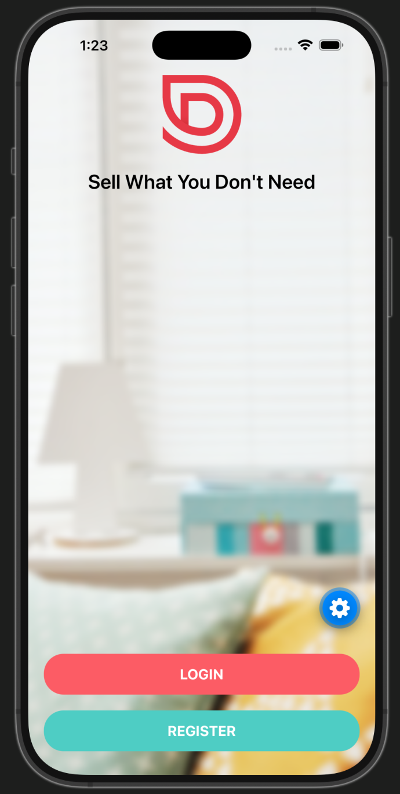
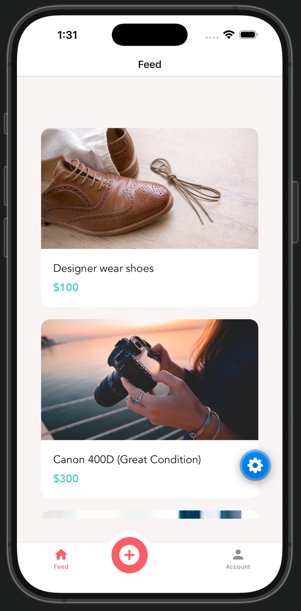
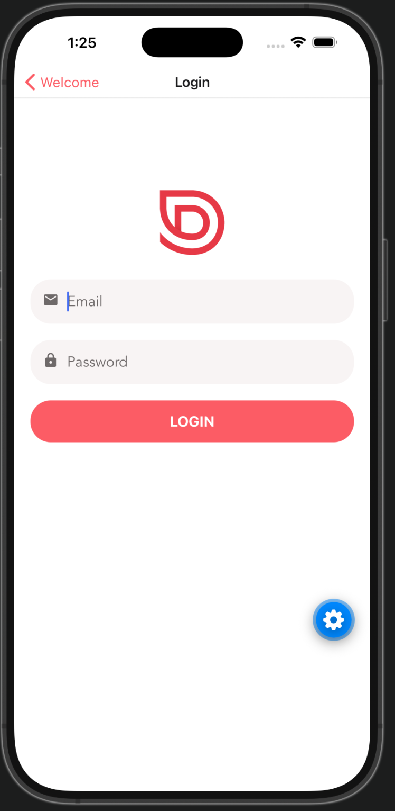

# Done With It

A cross-platform mobile marketplace application built with **React Native and Expo**. Users can create an account, authenticate, browse marketplace listings, view listing details, create new listings with photos, and manage their account.

This project gave me hands-on experience building a mobile application that communicates with a REST API and handles authentication, navigation, forms, images, device functionality, and persistent user sessions.

---

## Screenshots

| Welcome                                                  | Listings                                                   | Listing Details                                     |
| -------------------------------------------------------- | ---------------------------------------------------------- | --------------------------------------------------- |
|  |  |  |

| Create Listing                                             | Account                                             | Login                                                  |
| ---------------------------------------------------------- | --------------------------------------------------- | ------------------------------------------------------ |
|  |  |  |

---

## Features

### Authentication

- User registration
- User login and logout
- JWT-based authentication
- Persistent authentication using secure local storage
- Automatic restoration of the authenticated user when the application launches

### Marketplace

- Browse marketplace listings
- View listing details
- Display listing images
- Create new listings
- Add multiple images to a listing
- Select images from the device photo library

### Forms & Validation

- Reusable form components
- Form state management with Formik
- Input validation with Yup
- Registration and login validation
- User-friendly API and validation error messages

### Navigation

- Stack navigation
- Bottom tab navigation
- Separate authenticated and unauthenticated navigation flows
- Nested navigators
- Custom navigation components

### Device Features

- Image library access
- Location access
- Secure token storage
- Network connectivity detection
- Loading and error states

### Backend Integration

- REST API communication
- User registration and authentication endpoints
- Marketplace listing endpoints
- Asynchronous API requests
- Reusable API request hooks
- Loading and error handling

---

## Tech Stack

### Mobile Application

- React Native
- Expo
- JavaScript
- React Hooks
- React Navigation

### Forms & Validation

- Formik
- Yup

### API & Data

- REST APIs
- Apisauce / Axios
- JWT authentication

### Expo & Native Features

- Expo SecureStore
- Expo Image Picker
- Expo Location
- Expo Notifications
- Expo Constants

### Development Tools

- Git
- GitHub
- npm
- Expo CLI
- EAS Build
- iOS Simulator
- Xcode

---

## Application Architecture

The application follows a component-based architecture and separates UI, navigation, authentication, API communication, and reusable functionality into different modules.

A simplified flow looks like:

```text
React Native Application
        |
        v
Reusable Components
        |
        v
Screens & Navigation
        |
        v
Custom Hooks / API Layer
        |
        v
REST API
        |
        v
Backend / Data
```

Authentication follows a similar flow:

```text
Register / Login
       |
       v
Authentication API
       |
       v
JWT Token
       |
       v
SecureStore
       |
       v
Auth Context
       |
       v
Authenticated Navigation
```

The application uses React Context to store the authenticated user and conditionally displays either the authentication navigator or the main application navigator.

---

## Project Structure

```text
DoneWithIt/
│
├── app/
│   ├── api/
│   ├── assets/
│   ├── auth/
│   ├── components/
│   ├── config/
│   ├── hooks/
│   ├── navigation/
│   ├── screens/
│   └── utility/
│
├── App.js
├── app.json
├── eas.json
├── package.json
└── README.md
```

### Key Directories

**`api/`**  
Contains API clients and functions used to communicate with the backend.

**`auth/`**  
Contains authentication context, token storage, and authentication-related hooks.

**`components/`**  
Contains reusable UI and form components.

**`hooks/`**  
Contains reusable custom React hooks such as API request handling.

**`navigation/`**  
Contains stack, tab, authentication, and account navigators.

**`screens/`**  
Contains the application's main screens.

---

## Custom Hooks

The application includes custom hooks to reduce duplicated logic.

### `useApi`

Handles API request state including:

- Data
- Loading state
- Error state
- API execution

Example usage:

```javascript
const {
  request: loadListings,
  data: listings,
  error,
  loading,
} = useApi(listingsApi.getListings);
```

### `useAuth`

Provides authentication functionality throughout the application, including:

- Current authenticated user
- Login
- Logout
- Authentication state updates

---

## Authentication Flow

When a user logs in:

1. The application sends the user's credentials to the authentication API.
2. The backend returns a JWT authentication token.
3. The token is decoded to retrieve user information.
4. The user is stored in React Context.
5. The token is securely saved using Expo SecureStore.
6. The application switches from the authentication navigator to the main application navigator.

When the application starts again, the saved token is retrieved so the user does not need to log in again.

---

## API Integration

The application communicates with a REST API through a centralized API client.

Example:

```javascript
import { create } from "apisauce";

const apiClient = create({
  baseURL: "http://localhost:9000/api",
});

export default apiClient;
```

API functionality includes:

- Retrieving listings
- Creating users
- Authenticating users
- Submitting marketplace listings

### Local Development Note

When using the iOS Simulator on the same Mac as the backend:

```text
http://localhost:9000
```

can be used.

When testing on a physical device, `localhost` refers to the phone itself. The backend must instead be accessed through the development computer's local network address or another accessible backend URL.

---

## Running the Project

### Prerequisites

Install:

- Node.js
- npm
- Expo
- Xcode and iOS Simulator for iOS development

### Clone the Repository

```bash
git clone <https://github.com/DGT-INT/Market_Place_Mobile_App.git>
cd DoneWithIt
```

### Install Dependencies

```bash
npm install
```

### Start Expo

```bash
npx expo start
```

Press:

```text
i
```

to launch the application in the iOS Simulator.

---

## Backend

This application uses a separate REST API backend for authentication and marketplace data.

The backend must be running for functionality such as registration, login, and marketplace listings to work.

For local development, the backend runs on:

```text
http://localhost:9000
```

---

## EAS Build

The project has also been configured with **Expo Application Services (EAS)** for modern Expo build workflows.

The application can be built for the iOS Simulator using an EAS preview build.

---

## Notifications

The project explores push notification concepts using Expo Notifications.

Because modern versions of Expo no longer support remote push notifications through Expo Go, full remote notification functionality requires a development build.

The notification chapter of the original course used legacy Expo APIs, so this portion of the project was treated primarily as an exploration of concepts rather than a production push-notification implementation.

Key concepts covered include:

- Requesting notification permissions
- Push notification tokens
- Sending device tokens to a backend
- Remote notification architecture
- Handling notifications in a mobile application

---

## What I Learned

This project helped strengthen my understanding of React Native application development and the interaction between mobile frontends and backend services.

Some of the key concepts I practiced include:

- Building reusable React Native components
- Managing component state with `useState`
- Performing side effects with `useEffect`
- Creating custom React hooks
- Building reusable form components
- Form management with Formik
- Data validation with Yup
- Calling asynchronous REST APIs
- Handling API loading and error states
- JWT authentication
- Persisting authentication securely
- React Context
- Stack and tab navigation
- Nested navigation
- Image selection and display
- Device permissions
- Location services
- Debugging mobile applications
- Working with the iOS Simulator
- EAS Build and mobile distribution concepts

---

## Known Limitations

This project is intended primarily as a learning and portfolio project rather than a production marketplace.

Current limitations include:

- The backend is configured primarily for local development.
- Remote push notifications are not fully configured for production.
- The iOS build is currently intended for the iOS Simulator.

---

## Future Improvements

Potential improvements include:

- Deploying the backend to a cloud environment
- Adding production-ready push notifications
- Expanding automated testing
- Improving error monitoring
- Improving loading and empty states
- Adding more robust image handling
- Improving accessibility
- Adding TypeScript
- Improving responsive styling across devices
- Adding CI/CD
- Creating production Android and iOS builds

---

## Author

**Daniel Tshiani**

Software Engineer | Data Scientist

GitHub: https://github.com/DGT-INT

Portfolio: https://dgt-international.com

LinkedIn: https://www.linkedin.com/in/daniel-tshiani/
